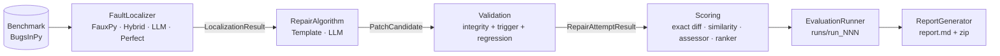

# Architecture

Repair Framework is built from small, replaceable parts. Each stage of the
pipeline (benchmark access, fault localization, repair, evaluation, reporting) sits
behind an abstract base class, so you change behaviour by passing in a different
concrete class. The rest of the pipeline does not change.

> Benchmark-specific details stay behind framework APIs. Repair, localization,
> evaluation and reporting are components you can replace or extend.

## Pipeline at a glance



## Core interfaces

| Concern | Interface | Implementations |
|---|---|---|
| Benchmark | `BenchmarkAdapter` (`benchmarks/base.py`) | `BugsInPyAdapter` |
| Fault localization | `FaultLocalizer` (`localization/base.py`) | `FauxPyLocalizer`, `HybridFaultLocalizer`, `LLMFaultLocalizer`, `PerfectFaultLocalizer` |
| Repair | `RepairAlgorithm` (`repair/base.py`) | `TemplateRepairAlgorithm`, `LLMRepairAlgorithm`, `DummyRepairAlgorithm` |
| Patch ranking | `PatchRanker` (`repair/ranking/base.py`) | `WeightedCompositeRanker` |
| LLM transport | `LLMClient` (`repair/llm/client.py`) | `OpenAICompatibleClient` |
| Evaluation | `EvaluationRunner` (`evaluation/base.py`) | `RepairEvaluationRunner`, `DummyEvaluationRunner`, comparison runners |
| Reporting | `ReportGenerator` (`reporting/base.py`) | `ArchiveReportGenerator` |

## Source layout

```text
src/apr_framework/
  core/
    models.py        # shared dataclasses: BugIdentifier, CheckoutResult, TestRunResult,
                     # LocalizationResult, RankedLocation, PatchCandidate, RepairAttemptResult,
                     # EvaluationResult, LocalizationConfig, RepairRunMetrics
    exceptions.py    # APRFrameworkError, BenchmarkError, ConfigurationError
  benchmarks/
    base.py          # BenchmarkAdapter interface (checkout / prepare_environment / run_tests / list_*)
    bugsinpy.py      # BugsInPyAdapter + BugsInPyToolchain (all Docker/shell calls go here)
    registry.py      # benchmark factory/registry
    executor_view.py # keeps the executor's view of host-side writes and deletions current
  cli/
    parser.py        # argparse grammar
    app.py           # command dispatch
  localization/
    base.py          # FaultLocalizer interface
    fauxpy.py        # FauxPy localizer, config, toolchain, and output parser
    hybrid.py        # weighted SBFL + MBFL result combiner
    perfect.py       # oracle locations from the developer fix (bug_patch.txt)
    llm.py           # LLM-based fault localizer
    prompts/         # fl_prompt1.txt
    scripts/         # in-place FauxPy patches (extra SBFL metrics, MBFL mutant selection)
  repair/
    base.py          # RepairAlgorithm interface (+ repair_loop / llm_query_count hooks)
    dummy.py         # random ground-truth / no-op repair component
    correctness.py   # exact-diff match + context similarity score
    regression.py    # regression half of plausibility + trusted-run check
    run_loop.py      # shared generate-and-validate budget loop
    patch_applier.py # the one validation path: screen -> apply -> test -> restore -> verify
    evaluator_integrity.py  # evaluator files: classify, reject edits, lock + verify, purge bytecode
    unified_diff.py  # parse multi-file unified diffs (any header style)
    ranking/         # PatchRanker, WeightedCompositeRanker, create_ranker()
    template/        # AST mutation operators, patch generator, validator
    llm/             # prompt builder, context enricher, few-shot, feedback,
                     # retrieval tools/protocol/loop, patch extractor, client
    assessment/      # LLM patch assessor + response parser + prompts
  evaluation/
    base.py                          # EvaluationRunner interface
    run_writer.py                    # runs/run_NNN/ writer
    dummy_runner.py                  # full APR pipeline for the dummy repair component
    repair_runner.py                 # RepairEvaluationRunner
    ground_truth.py                  # parse bug_patch.txt, rank ground truth in a ranking
    localization_runner.py           # evaluate-localization matrix
    repair_comparison_runner.py      # evaluate-repair matrix
    llm_repair_comparison_runner.py  # evaluate-llm-repair matrix
    course_approaches.py             # the four compared approaches, as data
    course_comparison_runner.py      # evaluate-course-comparison matrix
    repro_runner.py                  # evaluate-repro: Strict Repro over an explicit bug list
  reporting/
    base.py          # ReportGenerator interface
    archive.py       # report.md summary + zipped run artifacts
  challenge/         # Break This Fix (docs/challenges.md)
    bundle.py            # case bundles: load, validate, list, replay log
    multi_file_patch.py  # apply/restore multi-file diffs (create, delete) in pure Python
    replay.py            # `challenge run`: buggy / candidate / developer-fixed x repeats, witness
    report.py            # terminal tables
    agent_workspace.py   # answer-free agent workspace, shims, sync, diff capture
    shim_server.py       # serves the agent's test shims from outside its sandbox
    sealed_tests.py      # strips answers from the shim checkout; offline test container
    claude_code.py       # locked-down headless Claude Code run + transcript leak scan
    agent_run.py         # `challenge agent-run`: attempt -> capture -> clean evaluation -> runs/run_NNN
    prompts/             # claude_code_repair.txt
  repro/             # Strict Repro (docs/repro.md)
    issues.py            # issue pointers, GitHub fetch + cache, leak screen
    runner.py            # TestCommandRunner seam: BugsInPyCommandRunner, LocalPytestRunner
    source_view.py       # answer-free copy of the project for the retrieval tools
    generator.py         # issue -> test: retrieval, execution-feedback rounds, AssertFlip
    verifier.py          # failure classification, repeats, right-reason judge, F->P
    validation.py        # file states through apply_patch_and_validate, repro test while applied
    probes.py            # operator/drop/revert + test-aware LLM probes, confirmation rule
    strictness.py        # strictness arithmetic, hardening round
    contamination.py     # similarity of the generated test to the developer's trigger test
    spend.py             # metered LLM client, USD cap, list prices
    pipeline.py          # `repro new` / `repro check` wiring for BugsInPy and local targets
    report.py            # terminal table, runs/run_NNN artifacts, witness export
    models.py            # ReproIssue, TestVersion, Verification, Probe, ProbeResult, ...
    prompts/             # generation, feedback, AssertFlip, judge, probe, hardening templates
    data/                # bugsinpy_issues.json (project:bug -> issue URL; no issue text)
  evidence/          # shared by the evidence commands (behaviour-diff, ...)
    target.py            # EvidenceTarget: BugsInPyTarget (executor) or LocalTarget; SuiteCommand
    versions.py          # FixVersion: buggy / reference / candidates, loading, dedupe, exact apply
  behaviour/         # Behaviour Diff (docs/behaviour-diff.md)
    driver.py            # standalone script run in the target's interpreter: traces focus calls
    focus.py             # which functions each version changes, spans per version
    amplify.py           # one-literal variants of the tests that reach the focus
    observe.py           # apply a version, run the driver, read its record, restore
    compare.py           # noise calibration, divergences, behaviour classes
    pipeline.py          # discovery -> variants -> observe every version -> restore -> compare
    report.py            # terminal summary, leads.md, run artifacts
  tamper/            # Tamper Check (docs/tamper-check.md)
    test_ast.py          # test functions, assertion atoms, skips, swallowing try blocks
    classify.py          # per-test comparison: deleted, skipped, loosened, rewritten, added
    config_checks.py     # conftest.py, pytest options, Makefile/tox/nox/CI test commands
    source_checks.py     # runner detection, test literals in source decisions
    changes.py           # change sets from a diff or from `git diff <base>`
    pipeline.py          # file classification, static findings, fail-before/pass-after runs
    report.py            # terminal report
  grip/              # Fix Grip (docs/grip.md)
    variants.py          # hunks, hunk reverts, line probes (reusing repro/probes.py)
    pipeline.py          # baseline runs with line watching, variant runs, verdicts
    report.py            # terminal report, not_noticed/*.diff
```

```text
challenges/          # case bundles (case.json, candidate.diff, witness/, NOTES.md)
scripts/             # audit_test_edits.py, revalidate_saved_patches.py, preflight_bugs.py, ...
```

## Design decisions

**Shared domain models.** Components exchange `BugIdentifier`, `CheckoutResult`,
`TestRunResult`, `PatchCandidate`, `RepairAttemptResult` and `EvaluationResult`
objects from `apr_framework.core.models`, not benchmark-specific strings passed
through the whole system. That gives the framework stable domain definitions to
build on. The models are still evolving and may change as new implementations are
added.

**Benchmark commands are hidden.** Framework code calls
`BenchmarkAdapter.checkout`, `prepare_environment` and `run_tests`. BugsInPy commands
such as `bugsinpy-checkout`, `bugsinpy-safe-compile` and `bugsinpy-test` stay inside
`BugsInPyAdapter` and `BugsInPyToolchain`.

**BugsInPy runs in a sibling Docker container.** BugsInPy needs old Python versions
and a separate environment per project. Those are not installed into the framework
environment. Instead, the framework controls a long-lived executor container named
`apr-bugsinpy-executor`. The framework container stays small: it needs only Python,
Git and the Docker CLI. If `APR_HOST_PROJECT_ROOT` is not set, the executor
container's volume mounts fail.

**Multi-Python BugsInPy fork.** Upstream BugsInPy is tied to a single Python version.
The framework uses its own fork ([Sonzakir/BugsInPy](https://github.com/Sonzakir/BugsInPy.git)),
which supports several Python versions inside one Docker environment. The same
changes were submitted upstream as
[soarsmu/BugsInPy#110](https://github.com/soarsmu/BugsInPy/pull/110). The fork:

- replaces the fixed `python:3.12-slim-trixie` base image;
- adds `pyenv` to the image, so several Python versions can be installed and selected in one container;
- installs Python versions lazily, only when a checked-out project is compiled;
- adds a `bugsinpy-safe-compile` wrapper. The wrapper reads the required Python version from the checkout's `bugsinpy_bug.info`, pins it with a checkout-local `.python-version`, then runs the existing `bugsinpy-compile` without Python version clashes.

**Local paths separate tools from experiments.**

```text
.tools/bugsinpy        # local BugsInPy clone and metadata
.workspace/bugsinpy/   # checked-out buggy projects and evaluation worktrees
runs/run_NNN/          # structured single-run outputs
experiment_results/    # evaluation-matrix outputs (results.json + README.md)
```

**Repair is replaceable.** Every repair backend implements the same `RepairAlgorithm`
interface, from the dummy component to the template and LLM engines.

**FauxPy is isolated behind the localization interface.** `FauxPyLocalizer`
implements `FaultLocalizer`. `FauxPyToolchain` handles command execution, FauxPy
installation checks, pytest invocation and output parsing. The rest of the
framework consumes structured `LocalizationResult` and `RankedLocation` objects and
never parses FauxPy output directly.

**FauxPy metrics are reusable.** The configured metric drives the primary ranking
the CLI shows. Every metric table parsed from FauxPy output is also stored in
`metadata["all_metrics"]`, so Tarantula, Ochiai, D*, Jaccard, WSBI and any other
emitted table stay available to later repair or reporting components.

**One validation path, with evaluator integrity built in.** Every candidate, whether
from the template engine, the LLM engine, or an external agent replayed by
`challenge`, is validated by `repair/patch_applier.py::apply_patch_and_validate`. It
rejects candidates that edit evaluator files (tests, fixtures, test configuration,
BugsInPy scripts) or detect the test runner, locks the evaluator files and verifies
them after every run, purges the bytecode of touched files, and reports
`regression_checked` honestly. Rejections get their own status (`rejected`) and are
written out as evidence. See [Validation](validation-and-scoring.md#evaluator-integrity).

**Agents run on the host, evaluation stays in the executor.** `challenge agent-run`
must run where the agent CLI is logged in, so it runs on the host and drives the same
executor container. The agent works in a copy of the project outside the repository;
its test scripts only exchange files with a harness thread that runs the tests in the
executor. The tests the agent triggers run in a sealed, offline container that sees
only that attempt's checkout. See [Break This Fix](challenges.md#fresh-agent-attempts-challenge-agent-run).

**Host-side writes are made visible to the executor.** Docker Desktop's file sharing
caches file sizes and directory entries, so when the framework runs on the host a
rewritten file can look truncated to the executor and a deleted file can still look
present (measured: a rewritten 83-byte `bugsinpy_run_test.sh` read as its old 44
bytes). Before every command it runs from the host, `BugsInPyDockerExecutor` removes
the paths the host deleted (recorded by `benchmarks/executor_view.py`) and walks the
command's checkout, which refreshes the cached view. Checkout trees the executor
recreates are deleted from inside the executor. Container mode never needed this;
writes between containers are coherent.

**Strict Repro reuses the validation path through a runner seam.** `repro/` runs tests
either in the BugsInPy executor or with a local interpreter. Its `TestCommandRunner`
exposes `run_tests(checkout, timeout, command)`, the only adapter method
`apply_patch_and_validate` calls, so fixes and wrong-fix probes go through the same
integrity gate, restore and verification in both modes without touching the modules
that hard-code `BugsInPyAdapter`. See [Strict Repro](repro.md).

**Evidence commands observe; they do not judge plausibility.** `behaviour-diff`,
`grip` and `tamper-check --run-tests` apply each version with `MultiFilePatch` and
run a driver script in the target's own interpreter (`evidence/target.py`: the
BugsInPy executor or a local Python). The driver traces the changed functions
while the project's tests run.

These commands do not go through `apply_patch_and_validate`, because they never
decide whether a patch is plausible. They keep its guarantees themselves:

- an exact restore and a bytecode purge after every version;
- a checkout fingerprint check after every version;
- an evaluator-guard verification at the end;
- SIGTERM and SIGHUP end them through the same restore path.

Behaviour Diff's temporary test variants are covered by these checks too. See
[Behaviour Diff](behaviour-diff.md).

**One validation loop.** The generate-and-validate budget loop lives in
`repair/run_loop.py`, not inside any algorithm. It uses only the `RepairAlgorithm`
methods (`generate_patches` / `validate_patch`), so `RepairEvaluationRunner` and
every backend share a single implementation.

## Extension points

| Hook | Where | Default | Overridden by |
|---|---|---|---|
| `RepairAlgorithm.repair_loop(bug, checkout, *, budget, stop_on_first)` | `repair/base.py` | delegates to `run_validation_loop` | `LLMRepairAlgorithm` when `--iterative` is set |
| `RepairAlgorithm.llm_query_count()` | `repair/base.py` | `None` | `LLMRepairAlgorithm` (reports its client's call count) |
| `LLMClient` | `repair/llm/client.py` | — | add a subclass to support a new provider; `LLMRepairAlgorithm` is unchanged |
| `PatchRanker` / `create_ranker()` | `repair/ranking/` | `none` | `WeightedCompositeRanker` (`--ranker weighted`) |
| `BenchmarkAdapter` / registry | `benchmarks/` | BugsInPy | add an adapter + register it |
| `TestCommandRunner` | `repro/runner.py` | `BugsInPyCommandRunner`, `LocalPytestRunner` | add a runner (e.g. a container for local mode); its `run_tests` has the adapter's shape, so `apply_patch_and_validate` drives it unchanged |

`OpenAICompatibleClient` depends only on the narrow `LLMConnectionConfig` protocol
(`model_name`, `temperature`, `base_url`, `api_key_env_var`). Because of that, the
repair config and the LLM localization config both satisfy it without depending on
each other.

## Capability map

| Capability | Implementation / command |
| --- | --- |
| Benchmark interface | `BenchmarkAdapter` |
| Fault localization interface | `FaultLocalizer` |
| Repair interface | `RepairAlgorithm` |
| Evaluation interface | `EvaluationRunner` |
| Report interface | `ReportGenerator` |
| BugsInPy list projects/bugs | `bugsinpy list-projects`, `bugsinpy list-bugs` |
| BugsInPy checkout | `bugsinpy checkout` |
| BugsInPy prepare environment | safe compilation via `bugsinpy-safe-compile` and internal evaluation setup |
| BugsInPy run tests | `bugsinpy test` |
| Structured test results | `TestRunResult` with counts and raw output |
| FauxPy localization CLI | `localize --backend fauxpy --project <project> --bug <id>` |
| FauxPy metric selection | `localize --metric ochiai`, `localize --metric jaccard` |
| Hybrid localization | `localize --family hybrid --sbfl-metric ochiai --mbfl-metric metallaxis` |
| FauxPy granularity selection | `localize --granularity statement` / `--granularity function` |
| FauxPy output parser | `parse_fauxpy_output` parses all metrics or one selected metric |
| FauxPy result metadata | `LocalizationResult.metadata["all_metrics"]` stores every parsed metric table |
| CLI entry point | `python -m apr_framework` and the `apr-framework` script |
| Dummy repair component | `DummyRepairAlgorithm` |
| Evaluation output handling | `runs/run_xxx/config.json`, `results.json`, `execution.log`, `*.zip` |
| Patch ranking | `WeightedCompositeRanker` via `--ranker weighted` (`--ranker-weights` to override) |
| Rank of first correct patch | `rank_of_first_correct` in the `repair_results.json` metrics block |
| Repair evaluation matrix | `bugsinpy evaluate-repair --bugs "tornado:14,scrapy:2,black:1" --fl-modes "auto,perfect"` |
| Repair evaluation output | `experiment_results/repair/results.json` + `README.md` + per-cell `run_artifacts/` |
| LLM repair context retrieval | `repair --technique llm --retrieval-budget 3` |
| LLM fault localization for repair | `repair --fl-backend llm` |
| Full LLM pipeline (one command) | `repair --technique llm --fl-backend llm --retrieval-budget 3 --assess --similarity-score` |
| Four-approach comparison | `bugsinpy evaluate-course-comparison --bugs "black:1,black:3"` |
| Comparison output | `experiment_results/course_comparison/results.json` + `README.md` + per-cell `run_artifacts/` |
| Evaluator-integrity gate | `apply_patch_and_validate` + `EvaluatorGuard`; status `rejected`, `integrity_rejections` in `repair_results.json` |
| Integrity audit of committed results | `python scripts/audit_test_edits.py` -> `experiment_results/INTEGRITY_AUDIT.md` |
| Re-validate saved patches | `python scripts/revalidate_saved_patches.py <run_dir>` |
| List / replay Break This Fix cases | `challenge list`, `challenge run <case-id> [--patch PATH] [--repeats 3]` |
| Fresh isolated agent attempt | `challenge agent-run --project P --bug N --agent claude-code` (host) |
| Pilot preflight | `python scripts/preflight_bugs.py project:bug ...` |
| Strict Repro (BugsInPy) | `repro new --project P --bug N` -> verified, probed, hardened test in `runs/run_NNN` |
| Strict Repro (local pytest project) | `repro new --repo PATH --python PY --allow-local-exec --issue-file issue.md` |
| Judge a fix with a repro test | `repro check <repro-dir> --patch fix.diff [--harden]` |
| Strict Repro evaluation | `bugsinpy evaluate-repro --bugs ... --max-usd 5` -> `experiment_results/strict_repro_<date>/` |
| Behaviour Diff | `behaviour-diff --project P --bug N --from-run runs/run_NNN [--patch fix.diff]` -> classes, divergences, `leads.md` |
| Tamper Check | `tamper-check --diff agent.diff --repo PATH` / `--git-base REV` / `--run-tests` -> findings, exit 1 on weakening |
| Fix Grip | `grip --project P --bug N --developer-fix` / `--patch fix.diff` -> pinned / not pinned / not executed hunks |
