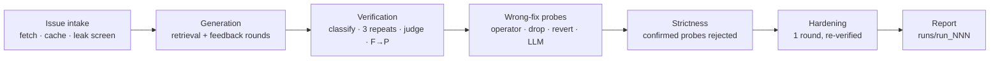

# Strict Repro

Turn a bug report into a failing pytest test you can trust. The test must fail on
today's code **for the reason the report describes**, and it must **reject
plausible-wrong fixes** that lax tests let through.

> **MVP.** Pytest projects only. BugsInPy bugs need a linked GitHub issue (167 of
> them have one and a pytest trigger). Local mode runs LLM-written code on your
> machine without container isolation.

## Two modes

| | BugsInPy (`--project --bug`) | Local (`--repo --python`) |
|---|---|---|
| Bug report | the bug's linked GitHub issue, fetched at run time | `--issue-file issue.md` or `--issue URL` |
| Where tests run | the BugsInPy executor (Docker), in the bug's own Python | your interpreter, `subprocess` with a timeout |
| Ground-truth fix | the developer fix, without its test sections | none until `repro check --patch` |
| Oracle that confirms a wrong fix | the bug's trigger test and its test file | `--regression-cmd` (optional) |
| Safety switch | — | `--allow-local-exec` (refused without it) |

## Commands

```bash
# BugsInPy: the issue comes from the bug's pointer; the developer fix is ground truth
python -m apr_framework repro new --project tqdm --bug 5 [--model gpt-5.4] [--max-rounds 3]

# Local pytest project (runs LLM-written code on this machine, hence the flag)
python -m apr_framework repro new --repo PATH --python PATH/.venv/bin/python --allow-local-exec \
  --issue-file issue.md            # or: --issue https://github.com/OWNER/REPO/issues/N
  [--regression-cmd "python -m pytest -q tests"]

# Judge a fix with an existing repro test (BugsInPy run dir or <repo>/.apr/repro/<id>)
python -m apr_framework repro check <repro-dir> --patch fix.diff [--harden]

# Evaluation over an explicit, pre-declared list (refuses to run without both flags)
python -m apr_framework bugsinpy evaluate-repro --bugs tqdm:1,tqdm:3 --max-usd 5
```

Every flag is in the [CLI reference](cli-reference.md#strict-repro-repro).

## Pipeline



1. **Issue intake** (`repro/issues.py`). The package ships only pointers
   (`repro/data/bugsinpy_issues.json`: `project:bug` → issue URL). Title and body are
   fetched from the GitHub API (with `GITHUB_TOKEN` if set) and cached under
   `.workspace/repro_issues/`, which git ignores. Comments are never fetched. The leak
   screen strips links to commits, pull requests, compare views and `.diff`/`.patch`
   files, pasted diffs and 40-character commit ids, and flags an issue that contained
   a diff or the fix commit id.
2. **Runner seam** (`repro/runner.py`). `BugsInPyCommandRunner` runs the test from a
   copy outside the checkout (its own `pytest.ini`, so the project's `conftest.py`
   and configuration never apply) through `adapter.run_tests(command=...)`.
   `LocalPytestRunner` runs your interpreter in a subprocess, from a temporary copy.
   Both have the adapter's `run_tests` shape, so every fix and probe goes through the
   one validation path, `apply_patch_and_validate`.
3. **Generation** (`repro/generator.py`). The model sees the screened issue, the list
   of Python files, the names and opening lines of test files it may know about, and
   whatever it asks for with the retrieval tools. Retrieval runs on an
   **answer-free copy** of the project (`repro/source_view.py`): on BugsInPy it holds
   no evaluator file, so the developer's trigger test and any test file the fix
   touched stay hidden. After each round the test runs once on the buggy code; unless
   it fails for a real reason, the classified output is fed back (up to
   `--max-rounds`). `--strategy assertflip` first writes a test that *passes* by
   asserting the buggy behaviour, then inverts it.
4. **Verification** (`repro/verifier.py`).
   - Failure classification: only an `assertion` failure or an `exception` raised by
     the code under test (or one the issue names) can be a reproduction.
     `collection_error`, `setup_error`, `test_error` (NameError, bad import or a wrong
     call signature raised by the test itself), `no_tests`, `timeout` and
     `environment_error` cannot.
   - 3 repeats must fail the same way.
   - A separate **right-reason judge** (temperature 0) sees the issue and the failure
     output, never the fix, and must quote the issue sentence the failure matches. A
     quote that is not in the issue downgrades the label to `unclear`.
   - With a fix: the test must pass once it is applied (fail-to-pass).
5. **Wrong-fix probes** (`repro/probes.py`). Deterministic variants of the fix (an AST
   operator on a changed line, a changed statement replaced by `pass`, one change
   block reverted; `--max-probes`, seeded) plus up to 12 **test-aware LLM probes**
   (symptom suppression, input-specific shortcut, incomplete fix, behaviour
   substitution) that the model believes pass the test but are wrong. Each probe is
   applied through the integrity gate. A probe is **confirmed wrong** only when an
   oracle that the fix itself passes rejects it:
   - BugsInPy: it fails the bug's trigger test, or passes it and breaks a test in the
     bug's test file;
   - local: it fails `--regression-cmd`.

   Everything else is *unconfirmed* (maybe equivalent) and never counted; probes that
   do not apply or import are *invalid*. Oracle timeouts are unconfirmed.
6. **Strictness and hardening** (`repro/strictness.py`). Strictness = confirmed-wrong
   probes the test rejects ÷ confirmed-wrong probes. On BugsInPy the report also
   shows how many of them the bug's own trigger test rejects (the baseline).
   Hardening (`--harden`; on by default for BugsInPy `repro new`) runs one LLM round
   that adds assertions **only about behaviour the issue describes**, shown the
   confirmed-wrong probes the test accepts. The hardened test is kept only if it
   re-verifies (fails for the reported reason, passes on the fix); the same probe
   pool is then re-judged. Unconfirmed probes the hardened test rejects are listed for
   review: they may be valid alternative fixes.
7. **Report** (`repro/report.py`).

## Reading the report

```text
Strict Repro · tqdm:5 "tqdm(iterable) total is None for generators with __len__"
Test: runs/run_NNN/test_repro_tqdm_5.py   (2 generation rounds)
fails on current code      yes, 3/3 repeats   AssertionError: assert None == 3
fails for reported reason  yes  (judge: ...)
collection/import errors   none
passes on developer fix    yes (fails before, passes after)
wrong-fix probes           18 generated, 9 confirmed wrong, 7 unconfirmed, 2 invalid
  rejected                 7/9   (the bug's trigger test rejects 8/9)
  accepted (lax spots)     2: p03 drop tqdm/_tqdm.py:812 · p11 incomplete_fix tqdm/_tqdm.py:790
hardened test (1 round)    rejects 9/9   (the bug's trigger test rejects 8/9), still passes on developer fix
similarity to trigger test 0.31
```

*(Illustrative layout, not a recorded run.)* "Similarity to trigger test" is the
highest token similarity between a generated test function and the developer's
trigger test (0.0–1.0; ≥ 0.8 is flagged as a possible near-copy, because BugsInPy is
public and a model may remember it).

## Outputs

| Path | Content |
|---|---|
| `runs/run_NNN/config.json` | command, target, model, temperatures, caps, list prices, prompt template hashes |
| `issue.json` | issue URL, SHA-256 and leak-screen flags. **Never the issue text.** |
| `prompts/` | the prompt templates as shipped, plus `sha256.json` |
| `tests/NN_<label>.py` | every generated test version, in order |
| `test_repro_<id>.py`, `repro.json` | the final test; for BugsInPy runs the run directory is a repro directory for `repro check` |
| `generation.json`, `verification.json` | each version's buggy-code run; the 3 repeats, judge verdict and F→P check |
| `probes/`, `probes.json` | every probe as a diff against the fix, with its oracle verdict and the repro verdicts before/after hardening |
| `llm_calls.json` | every LLM call: purpose, tokens, USD, a hash of the messages |
| `result.json`, `execution.log` | the summary and the log |
| `<repo>/.apr/repro/<id>/` | local mode: the final test and `repro.json` |
| `experiment_results/strict_repro_<date>/` | `evaluate-repro`: `results.json` (flushed after each bug) and a generated `README.md` |

`--export-witness DIR` writes a Break This Fix bundle draft (`case.json` with status
`candidate`, a unittest-compatible witness, `candidate.diff`, a `NOTES.md` stub) into
`DIR`. It never creates a case under `challenges/cases/`; see
[Break This Fix](challenges.md).

## Cost

Every call goes through a metered client that records tokens × list price (USD per
million tokens; gpt-5.4: 2.50 in, 15.00 out) and refuses a call that would exceed
`--max-usd` (default 2.00 per run). Models without a known price need
`--usd-per-mtok-in` and `--usd-per-mtok-out`.

## Limits

- Pytest only; unittest-only projects and bugs are out of scope.
- The right-reason label is an LLM judgement; its precision against the developer fix
  is what `evaluate-repro` measures.
- Hardening and LLM probes see the fix (by design), so a hardened test is fix-aware.
- Local mode has no container isolation. Every generated test is printed before it
  runs.
- Not included: a PR or issue bot, feeding the test into `localize`/`repair`,
  repro-based patch ranking, test minimization. Behaviour differences between
  fixes are covered by [Behaviour Diff](behaviour-diff.md).
